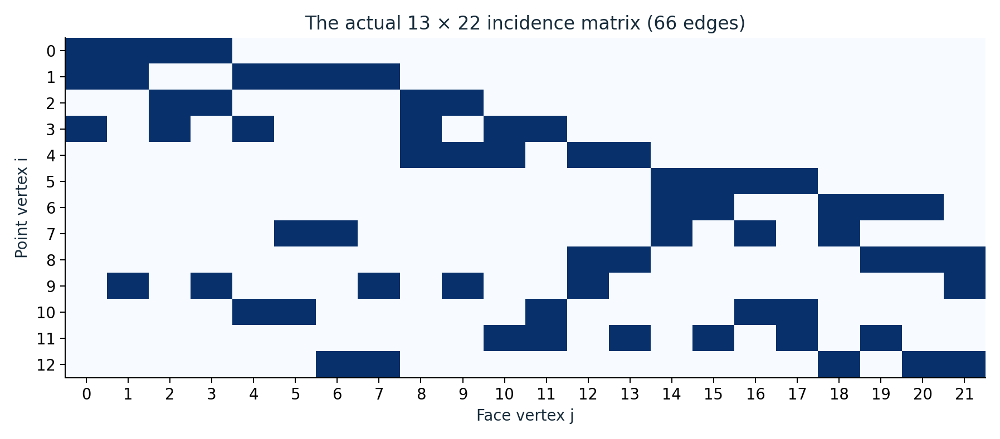
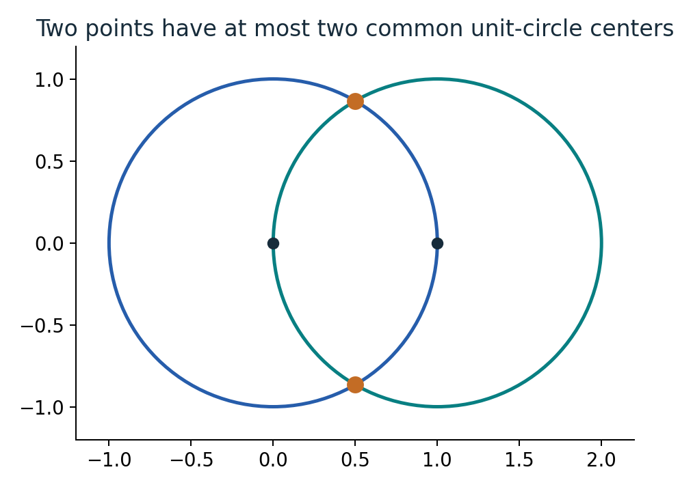
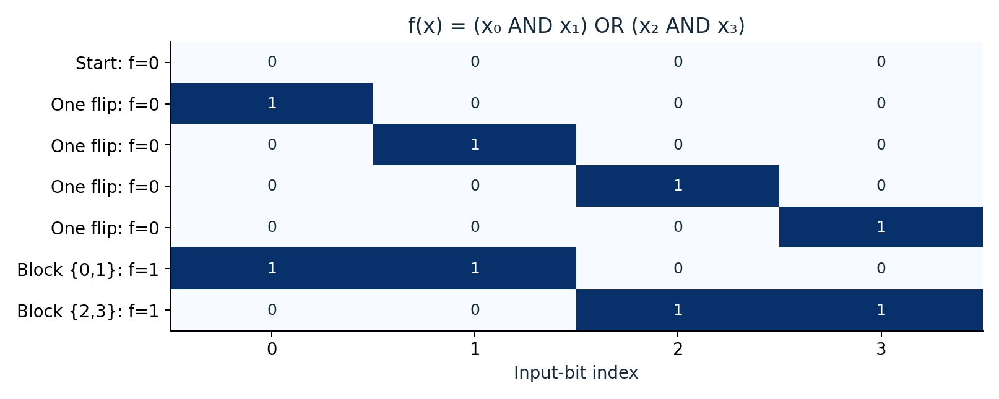

# OpenAI math, illustrated

Independent reading editions of OpenAI's mathematics manuscripts, with worked examples, diagrams that show the mathematical objects, and the complete original papers.

**First batch: five new guides, 30 new illustrations, and five expanded editions.** Start with the existing research topics below. The [integer-multiplication edition](https://github.com/rohanarun/integer-multiplication-illustrated) is available separately.

## Choose a paper

| Topic | What the guide helps you understand | Illustrated guide | Guide + original paper |
| --- | --- | --- | --- |
| [Van der Waerden numbers](papers/van-der-waerden/) | How long a coloring can avoid equally spaced, same-color patterns | [9 pages](papers/van-der-waerden/output/pdf/illustrated-guide.pdf) | [34 pages](papers/van-der-waerden/output/pdf/expanded-paper.pdf) |
| [Sidorenko's conjecture](papers/sidorenko/) | Why counting maps, correlations, and weighted rare events matters | [9 pages](papers/sidorenko/output/pdf/illustrated-guide.pdf) | [60 pages](papers/sidorenko/output/pdf/expanded-paper.pdf) |
| [Planar unit distances](papers/unit-distances/) | How geometry leads to sampling laws and an algebraic obstruction | [9 pages](papers/unit-distances/output/pdf/illustrated-guide.pdf) | [62 pages](papers/unit-distances/output/pdf/expanded-paper.pdf) |
| [Sensitivity and block sensitivity](papers/sensitivity/) | Why flipping groups of bits can differ from flipping individual bits | [9 pages](papers/sensitivity/output/pdf/illustrated-guide.pdf) | [20 pages](papers/sensitivity/output/pdf/expanded-paper.pdf) |
| [Matrix multiplication](papers/matrix-multiplication/) | How tensor coefficients, shared variables, and growth inequalities enter the 9/4 claim | [9 pages](papers/matrix-multiplication/output/pdf/illustrated-guide.pdf) | [22 pages](papers/matrix-multiplication/output/pdf/expanded-paper.pdf) |

Each paper directory embeds all six of its diagrams in its own README. The guide begins with familiar examples, then explains the source's mechanism and the points requiring deeper mathematics. The expanded PDF puts the guide first and reproduces **every original manuscript page afterward**, preserving original page numbers and bibliography. It is a companion-first reading edition, not inline annotations inside the original proof.

## A coloring is a concrete avoidance witness

This eight-position coloring avoids **every** monochromatic three-term arithmetic progression. Exhaustive enumeration finds no such coloring at nine positions. That finite check illustrates the definitions; the paper's large-parameter theorem requires a separate construction.


[Read how circles, norm shells, and probability enter the argument.](papers/van-der-waerden/)

## The Sidorenko pattern has an explicit incidence structure

This is the **actual 13-by-22 point-face incidence matrix extracted from the source**. Its 66 dark cells are the pattern's edges. The complete counterexample also needs a host with too few pattern maps; the incidence picture alone is not that host.



[Read the counting conventions and kernel examples.](papers/sidorenko/)

## Unit distances become circle incidences

Two points can have at most two common unit-circle centers. For points at `(0,0)` and `(1,0)`, the possibilities are `(1/2, ±√3/2)`. The guide connects this geometry to degree-weighted sampling and the later algebraic argument.



[Follow the geometry-to-probability-to-algebra route.](papers/unit-distances/)

## Individual flips and block flips ask different questions

For `(x₀ AND x₁) OR (x₂ AND x₃)`, no individual bit activates the all-zero input, while either of two disjoint pairs does. This is only a **local** gap: checking all inputs gives global sensitivity 2 and block sensitivity 2. The source needs a more elaborate construction to obtain its separation.



[Read why global maxima and joint sensitivities matter.](papers/sensitivity/)

## Tensor terms can be inspected one by one

In the source's smallest three-sector example, `C(2,4)`, each supported term satisfies `z=x+y`. Six terms survive the weight filter; two crossed terms disappear. These are explicit coefficient locations, not a generic flowchart.


[Read the finite construction and the exponent comparison.](papers/matrix-multiplication/)

## Coverage and scope

The pinned [OpenAI manuscript map](https://github.com/openai/math/blob/1581d4cbdd69a0faf34b2089614fe2a814316a6a/CONTENTS.md) lists **719 manuscripts across 372 families**. The [full catalogue](CATALOGUE.md) and [machine-readable index](catalogue.json) distinguish:

- **5 editions published here**;
- **1 existing integer-multiplication edition linked**;
- **713 manuscripts pending**.

The catalogue is not a claim that all 719 have been expanded. The priority is the user's existing research topics. No unattended publishing job is configured by this repository.

These are independent explanations of **source claims**, not official OpenAI revisions or independent validations of the complete theorems. OpenAI's own [collection README](https://github.com/openai/math/blob/1581d4cbdd69a0faf34b2089614fe2a814316a6a/README.md) notes that manuscripts are at different verification stages. Small examples, asymptotic expressions, and original constructions are labeled distinctly. No practical speedups or unspecified constants are invented.

The new matrix guide follows the **October 2, 2026 9/4 manuscript**, rather than substituting the separate abstract sector-obstruction analysis. The other guides likewise preserve the assumptions and attribution of their pinned originals.

## Editable sources and verification

- `papers/<topic>/content.json`: model-authored explanations, captions, glossary, and source anchors.
- `papers/<topic>/illustrated-guide.tex`: generated, editable LaTeX.
- `papers/<topic>/original/`: unchanged original PDF, manuscript sources, and citation.
- `papers/<topic>/figures/`: vector PDFs and PNGs of all illustrations.
- [source-manifest.json](source-manifest.json): pinned upstream commit and original file hashes.
- [example-checks.json](example-checks.json): finite example calculations and exhaustive checks.
- [verification.json](verification.json): build checks, rendered-page checks, and source-page preservation checks.
- [AUTHORING_GUIDE.md](AUTHORING_GUIDE.md): instructions for maintaining the explanatory standard in later batches.
- [Editable package](output/openai-math-illustrated-editable.zip): the complete published batch and its sources.

The prose was authored by the model after reading the manuscripts. The scripts render that authored text and generate mathematical figures from explicit examples; they do not summarize papers from titles or manufacture guides for pending entries.

### Rebuild

Use Python with NumPy, Matplotlib, PyMuPDF, and Pillow, plus Tectonic. Run from the repository root. In the author's environment all work, temporary files, and caches must stay on the mounted writable external SSD.

```sh
mkdir -p tmp/cache
export TMPDIR="$PWD/tmp"
export XDG_CACHE_HOME="$PWD/tmp/cache"
python3 generate_figures.py
python3 build_publication.py
python3 verify_publication.py
python3 package_release.py
```

Edit `content.json` directly for normal revisions. `author_content.py` records the initial authored batch; running it restores that text and overwrites those content files. `catalogue.py` rebuilds the catalogue from the pinned `catalogue-source.md` snapshot. Inspect every newly rendered guide page and diagram before publishing; checks of examples are not proof certification.

## Attribution and license

Original manuscripts: OpenAI, with each source's original references and citation retained. Explanations, illustrations, and publication scripts prepared with substantial OpenAI Codex assistance on October 14, 2026. Distributed under [Apache-2.0](LICENSE); see [NOTICE](NOTICE).
