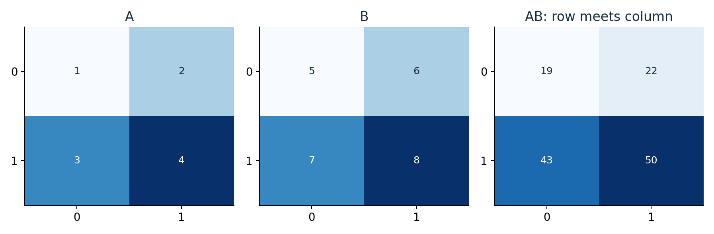
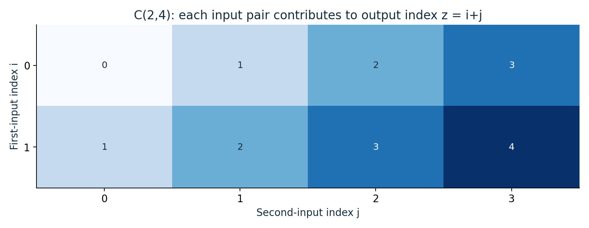
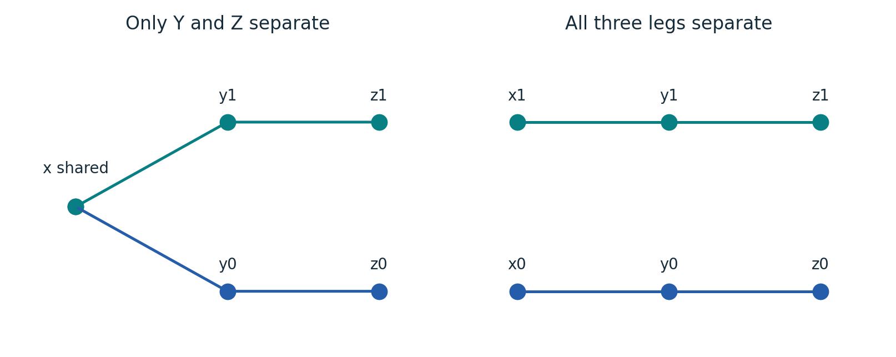
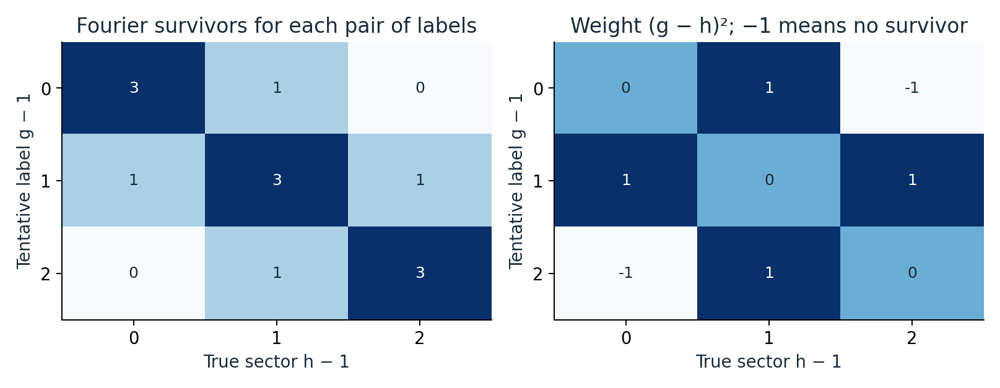
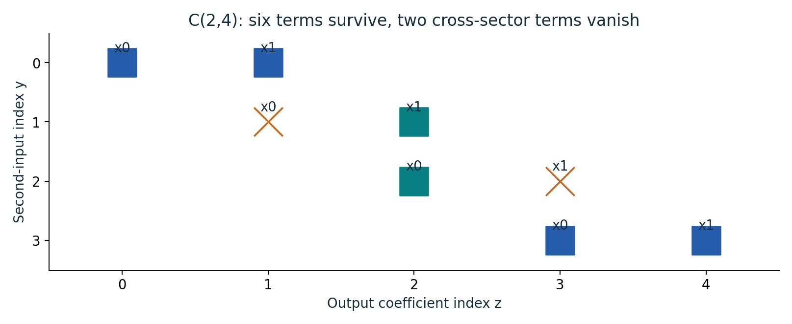
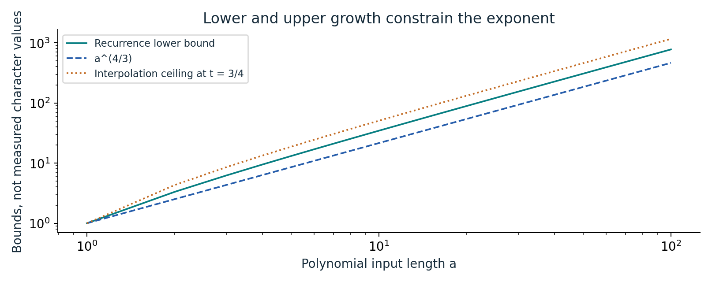

# How can a matrix product require fewer multiplications?

An illustrated reader for the source’s 9/4 exponent argument.

[Illustrated guide (9 pages)](output/pdf/illustrated-guide.pdf) · [Expanded edition (22 pages)](output/pdf/expanded-paper.pdf) · [Original source](https://github.com/openai/math/tree/1581d4cbdd69a0faf34b2089614fe2a814316a6a/preprints/Matrix-Multiplication-Nine-Fourths-October-2-2026)

Six concrete diagrams with worked examples. The expanded edition pairs the guide with every original manuscript page; the original proof and bibliography retain their numbering. This is an independent explanation, not an official OpenAI revision or independent theorem certification.

## Every output entry is a row-column dot product

The displayed product is [[19,22],[43,50]]. For example, its upper-left entry is 1×5+2×7=19, not the entrywise product 1×5.

**Where it fits:** Sections 1-2: arithmetic exponent, tensors, and equation (2.2).

## Polynomial multiplication has a concrete coefficient pattern

The C(2,4) array has eight input products. A cell (i,j) contributes to output coefficient i+j, producing output indices 0 through 4.

**Where it fits:** Section 4, equations (4.1)-(4.5); Lemma 2.2.

## Shared variables prevent a full direct sum

Left: x·y₀z₀+x·y₁z₁ shares its X variable. Right: x₀y₀z₀+x₁y₁z₁ uses independent variables on all three legs. These are different tensors.

**Where it fits:** Proposition 3.1 and Corollary 3.2.

## A Fourier filter and a square enforce matching labels

For M=3, the left table counts tuples surviving u−v+2(g−h)=0. Surviving terms have weight (g−h)²; weight zero requires g=h and then u=v.

**Where it fits:** Proposition 3.1 and Lemma 2.3.

## The three sectors are visible in the support

For a=2 and h=1, the source’s shifted-tripling construction uses C(2,4). Two supported terms receive weight +1 and vanish; six remain in three matched sectors.

**Where it fits:** Lemma 4.2 and original Figure 1.

## Compare forced growth with an interpolation ceiling

The curves show bounds from the discrete growth argument, not sampled values of an unknown tensor character. At t=3/4, the interpolation ceiling has the same asymptotic power 4/3.

**Where it fits:** Lemma 5.1, Theorem 1.1 proof, and Appendix A.

## Read and reproduce

The PDF develops each example step by step and explains what it does and does not establish. Editable prose is in [content.json](content.json); the [generated LaTeX](illustrated-guide.tex) is also included. Original files are under [original/](original/), bound by the collection [source manifest](../../source-manifest.json). See the [collection README](../../README.md) for generation and validation commands.
