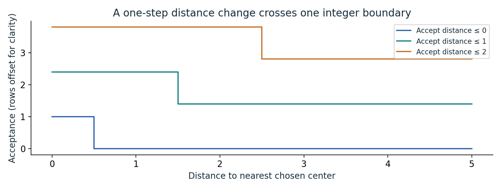
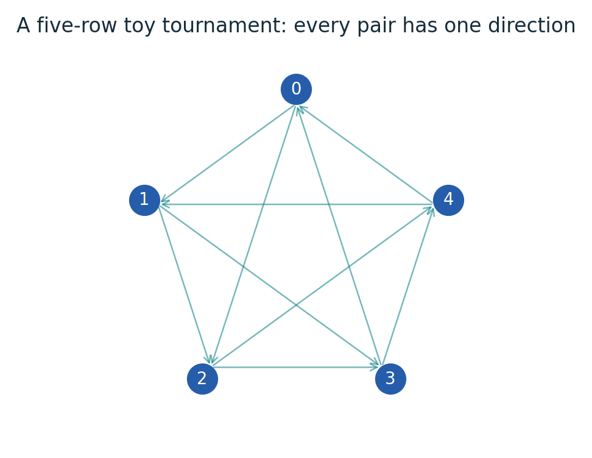
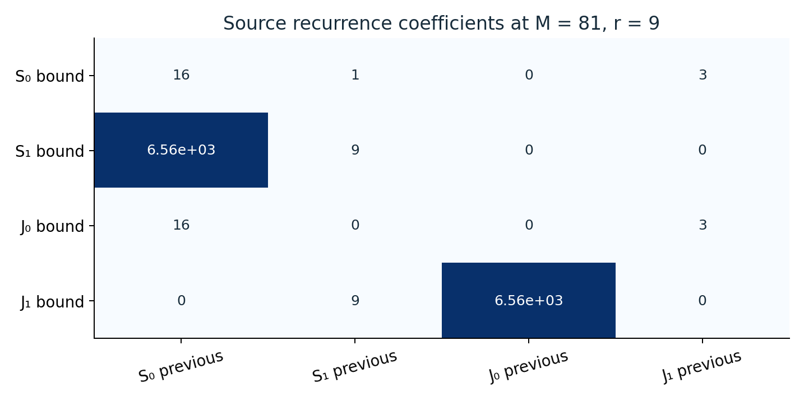
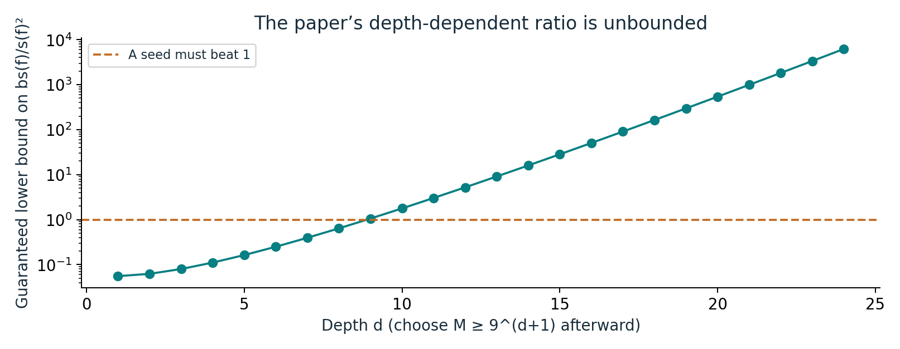
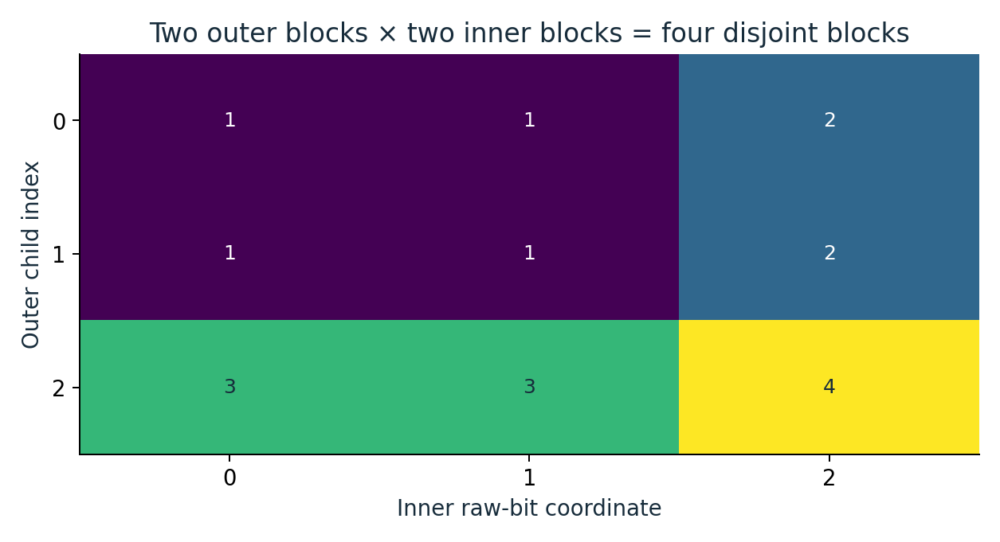

# One switch versus a whole group of switches

An illustrated reader for sensitivity and block sensitivity.

[Illustrated guide (9 pages)](output/pdf/illustrated-guide.pdf) · [Expanded edition (20 pages)](output/pdf/expanded-paper.pdf) · [Original source](https://github.com/openai/math/tree/1581d4cbdd69a0faf34b2089614fe2a814316a6a/preprints/A-superquadratic-separation-between-sensitivity-and-block-sensitivity-September-25-2026)

Six concrete diagrams with worked examples. The expanded edition pairs the guide with every original manuscript page; the original proof and bibliography retain their numbering. This is an independent explanation, not an official OpenAI revision or independent theorem certification.

## A local gap is not a global separation

For f=(x₀ AND x₁) OR (x₂ AND x₃), no single flip changes f at zero, but either of two disjoint pair flips does. Exhaustive checking gives global sensitivity 2 and block sensitivity 2.

**Where it fits:** Section 1 definitions; Section 2.4 disjoint blocks at zero.

## Nested predicates create distinct boundaries

The curves accept distances at most 0, 1, and 2. Their vertical offsets separate the drawing; each predicate itself takes only the values zero and one.

**Where it fits:** Sections 2.1 and 2.3: initial predicates and Lemma 2.2.

## A tournament gives every pair of rows one direction

This five-row cyclic tournament is a small structural illustration. Each row has two outgoing neighbors. It is not the paper’s labeled tournament with k=2M²+1 and M≥3.

**Where it fits:** Sections 2.2 and 3: recursive clauses and candidate-clause counting.

## Track joint sensitivity alongside ordinary sensitivity

The coefficient matrix displays the four inequalities from Proposition 3.1 at M=81 and r=9. Entries multiply previous-level upper bounds; they are not measured sensitivities.

**Where it fits:** Proposition 3.1 and Section 4 normalization.

## An exponential numerator eventually beats a quadratic denominator

The plotted source lower bound 2^d/[4(d+2)²] exceeds one at d=9 and tends to infinity. The construction dimension also grows enormously with the required parameter choices.

**Where it fits:** Theorem 1.1 proof, equations (7)-(10).

## Composition multiplies disjoint block witnesses

Each color labels one Cartesian-product block. Two disjoint outer blocks and two disjoint inner blocks give four pairwise disjoint raw-coordinate blocks.

**Where it fits:** Lemma 4.2 and Corollary 4.3.

## Read and reproduce

The PDF develops each example step by step and explains what it does and does not establish. Editable prose is in [content.json](content.json); the [generated LaTeX](illustrated-guide.tex) is also included. Original files are under [original/](original/), bound by the collection [source manifest](../../source-manifest.json). See the [collection README](../../README.md) for generation and validation commands.
