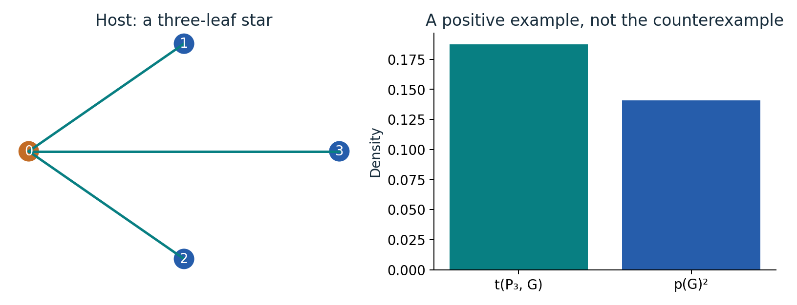
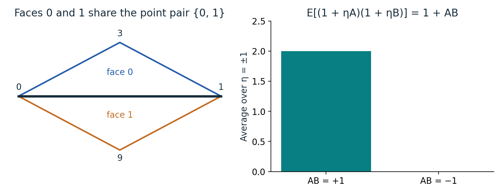
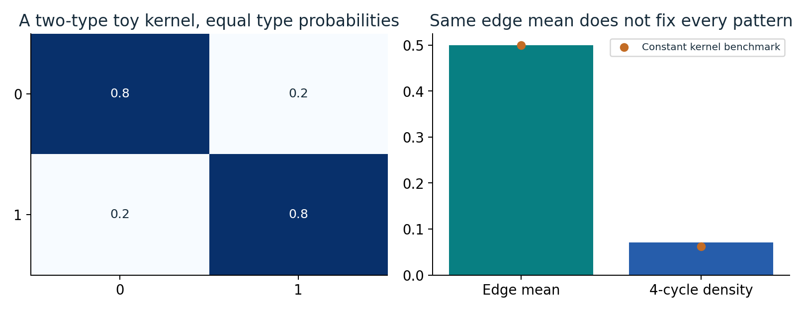
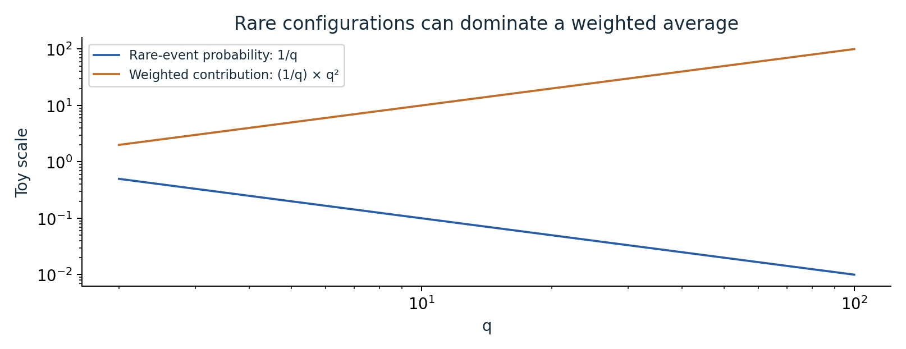
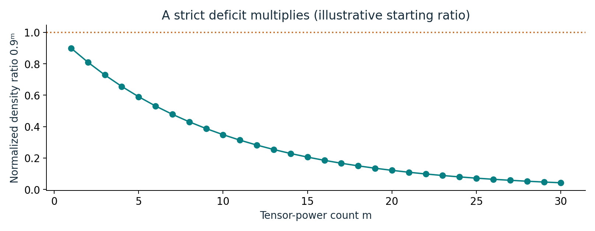

# Can a structured graph contain fewer patterns than randomness?

An illustrated reader for the proposed Sidorenko counterexample.

[Illustrated guide (9 pages)](output/pdf/illustrated-guide.pdf) · [Expanded edition (60 pages)](output/pdf/expanded-paper.pdf) · [Original source](https://github.com/openai/math/tree/1581d4cbdd69a0faf34b2089614fe2a814316a6a/preprints/A-counterexample-to-Sidorenkos-conjecture-September-23-2026)

Six concrete diagrams with worked examples. The expanded edition pairs the guide with every original manuscript page; the original proof and bibliography retain their numbering. This is an independent explanation, not an official OpenAI revision or independent theorem certification.

## Count maps, including repeated vertices

For a three-vertex path mapped into a three-leaf star, there are 12 homomorphisms. Its density 12/4³ exceeds the benchmark (6/4²)².

**Where it fits:** Section 1: density definitions; Section 8 distinguishes injective counts.

## The actual pattern is a point-face incidence graph

Each dark cell is an edge of the source pattern. Every face column has three entries; the 13 point rows and 22 face columns represent 35 distinct vertices.

**Where it fits:** Section 2, Table 1 and Proposition 2.1.

## Averaging one random sign retains a four-incidence interaction

Faces 0 and 1 share points 0 and 1. Averaging the product over an independent uniform sign η removes the linear terms and retains 1+AB.

**Where it fits:** Section 1 negative-correlation overview and Section 3 activation construction.

## A kernel is a table of edge probabilities

A two-type toy kernel has within-type probability 0.8 and between-type probability 0.2. Its edge mean is 0.5, but its four-cycle density is 0.0706 rather than 0.0625.

**Where it fits:** Section 1 kernel definitions; Section 3 construction and finite-host transfer.

## Small probability does not imply a small weighted contribution

A toy event has probability 1/q but weight q², so its contribution to the expectation is q. The two curves deliberately move in opposite directions.

**Where it fits:** Sections 5-7; the singular-contribution discussion on original page 3.

## One strict deficit can be amplified, with a density caveat

If an initial normalized pattern-density ratio were 0.9, independent tensor powers would give 0.9^m. The displayed 0.9 is illustrative, not a measured ratio for the source host.

**Where it fits:** Section 8 and Corollaries 1.2-1.3.

## Read and reproduce

The PDF develops each example step by step and explains what it does and does not establish. Editable prose is in [content.json](content.json); the [generated LaTeX](illustrated-guide.tex) is also included. Original files are under [original/](original/), bound by the collection [source manifest](../../source-manifest.json). See the [collection README](../../README.md) for generation and validation commands.
