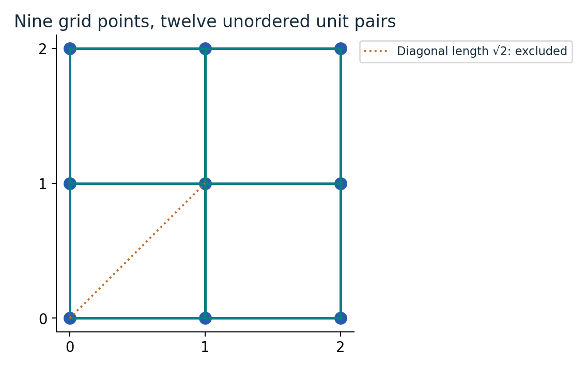
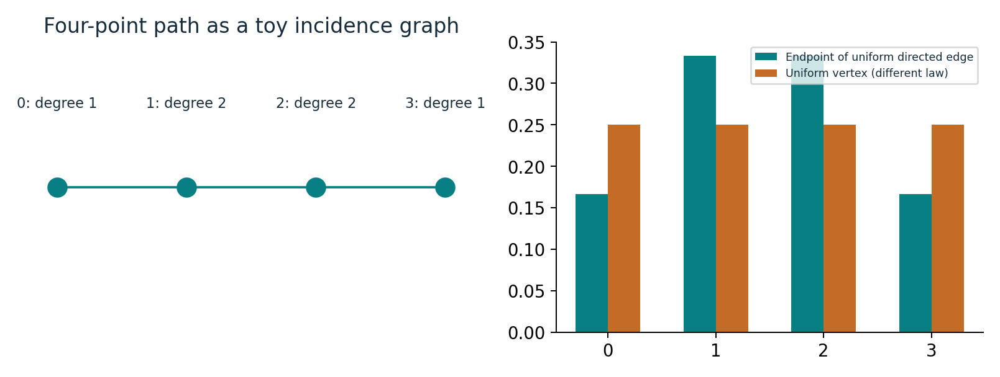
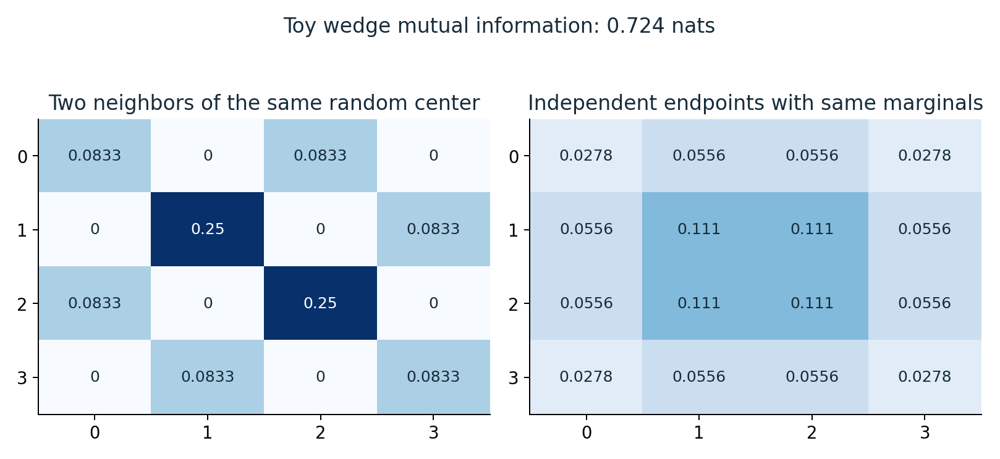
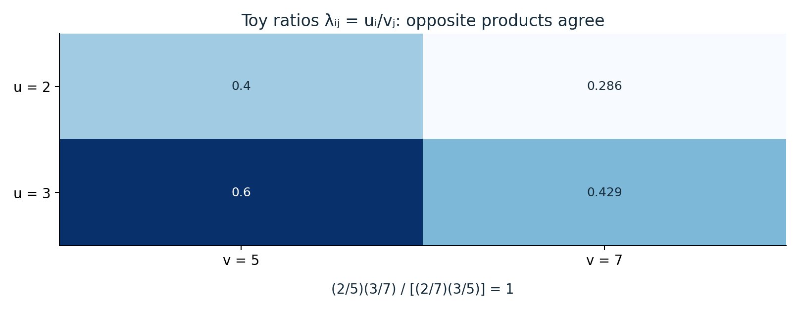
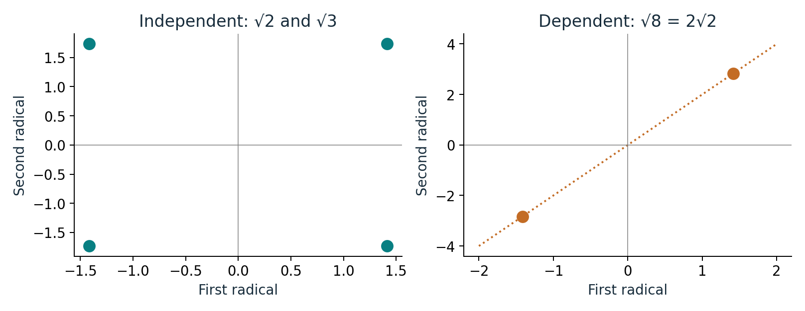

# How many pairs of points can be exactly one unit apart?

An illustrated reader for the planar unit-distance upper bound.

[Illustrated guide (9 pages)](output/pdf/illustrated-guide.pdf) · [Expanded edition (62 pages)](output/pdf/expanded-paper.pdf) · [Original source](https://github.com/openai/math/tree/1581d4cbdd69a0faf34b2089614fe2a814316a6a/preprints/A-power-saving-for-planar-unit-distances-September-23-2026)

Six concrete diagrams with worked examples. The expanded edition pairs the guide with every original manuscript page; the original proof and bibliography retain their numbering. This is an independent explanation, not an official OpenAI revision or independent theorem certification.

## Count unordered pairs and exclude the diagonals

A 3×3 integer grid has six horizontal and six vertical unit pairs. Diagonal neighbors have distance √2 and are excluded.

**Where it fits:** Section 1: u(X), u(n), and Theorem 1.1.

## Turn distance equations into circle incidences

The unit circles centered at (0,0) and (1,0) meet at (1/2, ±√3/2). Those are the two possible centers one unit from both points.

**Where it fits:** Section 2.2: point-circle incidences and the cutting construction.

## A random edge does not produce a uniform random vertex

In a four-vertex path, the endpoint marginal of a uniformly chosen directed edge is (1,2,2,1)/6. The middle vertices are twice as likely as the endpoints.

**Where it fits:** Sections 2-3: retained-edge law and conditional-copy prediction.

## Sharing a center creates dependence between neighbors

Left: choose a degree-weighted center, then two neighbors independently conditional on that center. Right: choose endpoints independently from their common marginal. The matrices differ.

**Where it fits:** Section 2: wedge law and mutual information; Section 3 prediction.

## A rectangle cancels shared multiplicative factors

For the toy ratios λᵢⱼ=uᵢ/vⱼ, multiplying opposite corners and dividing gives one exactly. The source obtains small height for analogous rectangle products.

**Where it fits:** Sections 4-7: product formula, scale, and height-weighted rectangle extraction.

## Independent square-root signs provide an obstruction

Over the rationals, √2 and √3 admit four independent sign choices in their common field. For √2 and √8, the relation √8=2√2 allows only two linked choices.

**Where it fits:** Section 8: generic configurations, valuations, and radical sign changes.

## Read and reproduce

The PDF develops each example step by step and explains what it does and does not establish. Editable prose is in [content.json](content.json); the [generated LaTeX](illustrated-guide.tex) is also included. Original files are under [original/](original/), bound by the collection [source manifest](../../source-manifest.json). See the [collection README](../../README.md) for generation and validation commands.
