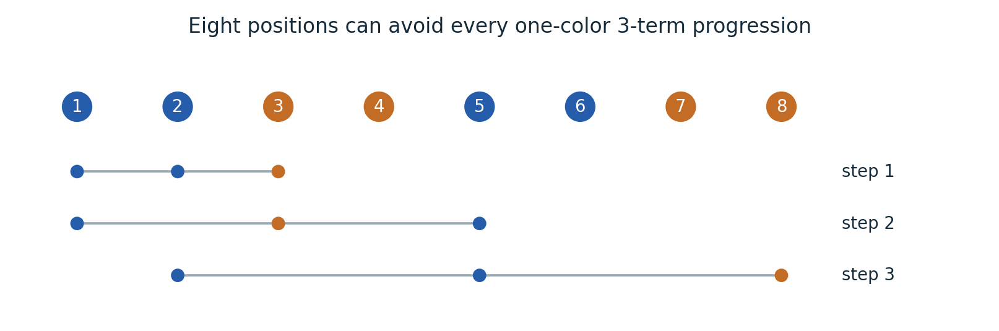
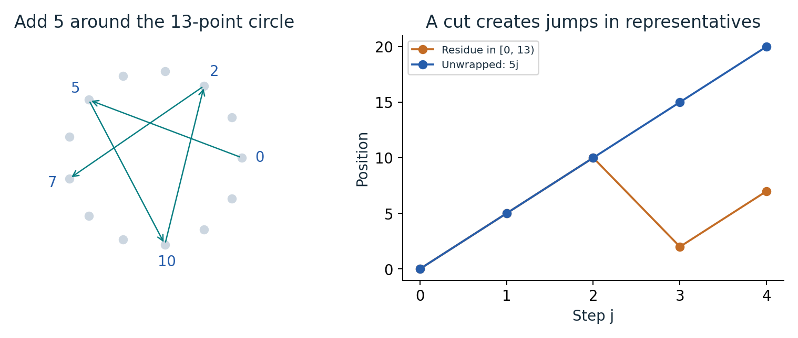
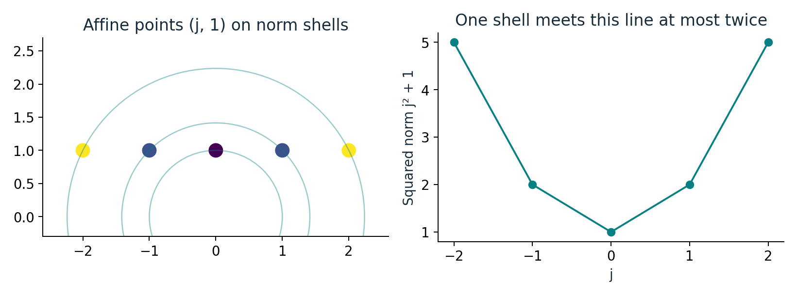
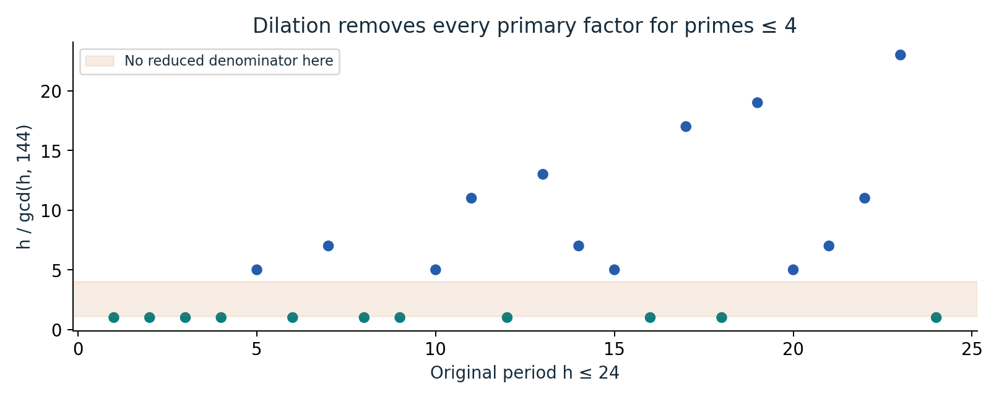
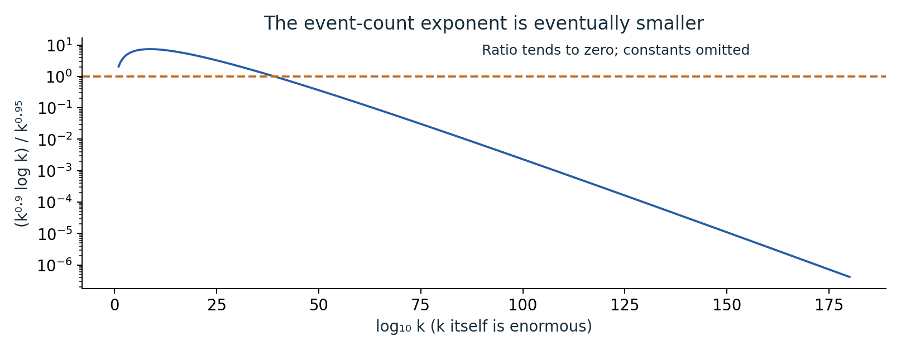
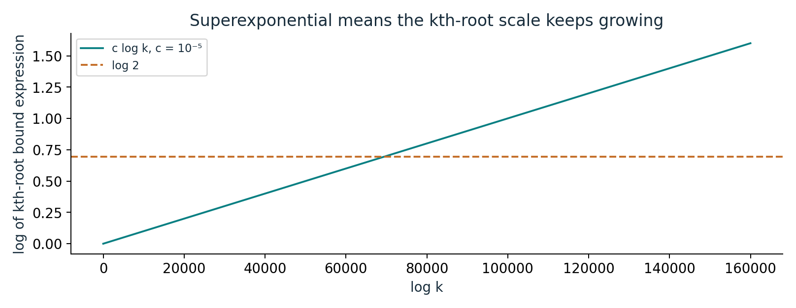

# How long can a coloring hide a progression?

An illustrated reader for superexponential van der Waerden bounds.

[Illustrated guide (9 pages)](output/pdf/illustrated-guide.pdf) · [Expanded edition (34 pages)](output/pdf/expanded-paper.pdf) · [Original source](https://github.com/openai/math/tree/1581d4cbdd69a0faf34b2089614fe2a814316a6a/preprints/Quantitative-Superexponential-Bounds-for-van-der-Waerden-Numbers-September-23-2026)

Six concrete diagrams with worked examples. The expanded edition pairs the guide with every original manuscript page; the original proof and bibliography retain their numbering. This is an independent explanation, not an official OpenAI revision or independent theorem certification.

## Read the quantifiers through an eight-position example

An exhaustively checked coloring of eight positions avoids all monochromatic three-term progressions. The lower rows illustrate three possible spacings; all spacings are checked by the script.

**Where it fits:** Section 1: definition of W_r(k) and Theorem 1.1.

## A circle has no cut; a coordinate interval does

The residues 0, 5, 10, 2, 7 follow a constant step modulo 13. Representatives in an interval jump at the cut; their unwrapped values 0, 5, 10, 15, 20 remain affine.

**Where it fits:** Sections 2 and 5: cyclic coordinates, adaptive mesh, balanced-or-affine alternative.

## Squared norm turns a line into a quadratic

For the toy affine points (j,1), the squared norm is j²+1. A circle of a fixed radius meets this line at at most two points.

**Where it fits:** Section 6: norm-indexed perturbation; Section 1 construction overview.

## A dilation removes troublesome small periods

In this arithmetic example, λ=144 contains the full powers of 2 and 3 needed for every h≤24. The reduced denominator h/gcd(h,144) is either 1 or greater than 4.

**Where it fits:** Lemma 2.1 and equations (2.1)-(2.3).

## Many bad events can still have total probability below one

The plotted ratio (k^0.9 log k)/k^0.95 tends to zero. It compares exponent scales from the proof overview, omitting constants; it is not a computed probability of success.

**Where it fits:** Sections 3-6; overview on original page 3.

## Why the conclusion is stronger than beating one exponential

The two-color lower-bound expression has logarithmic kth-root scale c log k. The constant line log 2 represents the kth root of 2^k. The source theorem applies only beyond its unspecified threshold.

**Where it fits:** Theorem 1.1 and Section 7: transfer to intervals and additional colors.

## Read and reproduce

The PDF develops each example step by step and explains what it does and does not establish. Editable prose is in [content.json](content.json); the [generated LaTeX](illustrated-guide.tex) is also included. Original files are under [original/](original/), bound by the collection [source manifest](../../source-manifest.json). See the [collection README](../../README.md) for generation and validation commands.
